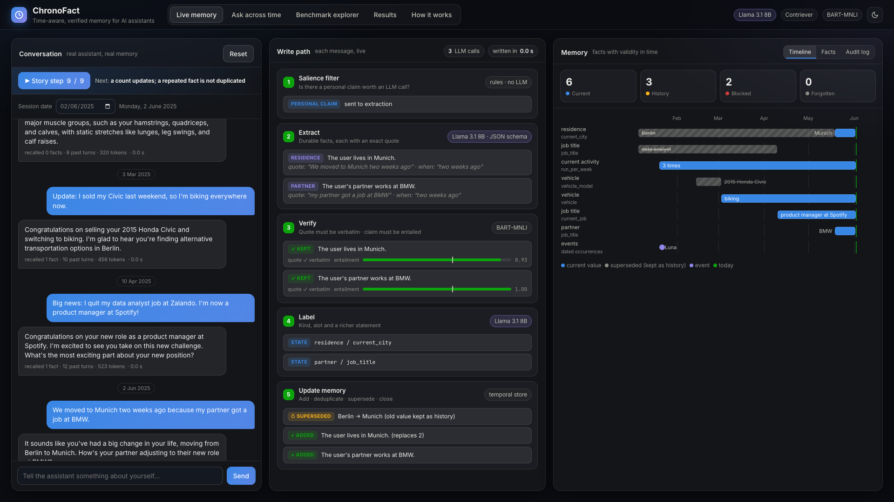
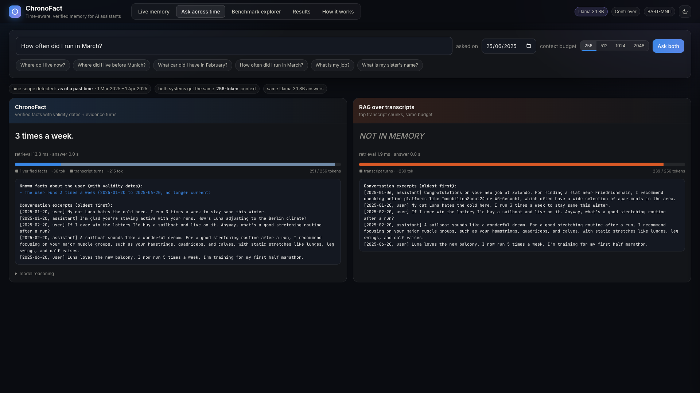
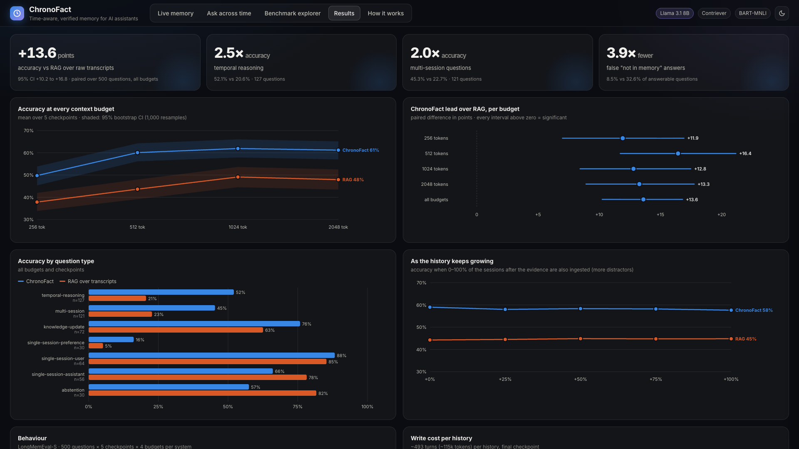

# ChronoFact

### Memory that knows *when* something was true, and *why* it believes it.

ChronoFact is a time-aware, verified memory layer for AI assistants, built entirely on Meta models.

Assistants that remember their users fail in two ways: they **store things the user never said**, and they **keep
answering with values that changed months ago**. ChronoFact turns a conversation stream into **verified, time-stamped
facts with provenance**, keeps their history when they change, and answers every question from a small, fixed context.

**+13.6 points over RAG** on LongMemEval · **2.5× on temporal reasoning** · **2.0× across sessions** · **3.9× fewer
false "I don't know"** · **$0 API cost on one GPU**

> 🎬 Demo video: _(link)_



## Why ChronoFact

Measured on LongMemEval-S (500 users, ~115k-token histories each, 10,000 judged answers per system), against RAG over
the raw transcripts with the same answering model (Llama-3.1-8B) and the same token budgets. Every number is the
effect of the complete ChronoFact system working together: verified temporal memory, time-scoped retrieval and
packing, and the answer step.

| advantage | evidence |
|---|---|
| **More accurate memory** | **+13.6 points** overall [95% CI +10.2, +16.8], significant at every budget from 256 to 2,048 tokens |
| **Gets time right** | **2.5×** accuracy on temporal reasoning (52.1% vs 20.6%); knowledge updates 75.8% vs 62.6% |
| **Connects sessions** | **2.0×** accuracy on questions that span several sessions (45.3% vs 22.7%) |
| **Does not give up wrongly** | **3.9× fewer** false "not in memory" answers (8.5% vs 32.6% of answerable questions) |
| **Never stores what was not said** | a fact must quote the user verbatim **and** pass an NLI entailment check: **43 unsupported facts blocked per history**. Asking for "tips for a flat near Friedrichshain" does not become "lives near Friedrichshain" |
| **Keeps the history** | a changed value supersedes the old one, which keeps its end date instead of being overwritten, so "now", "in March" and "what changed" all have answers; "two weeks ago" is resolved to a date when written |
| **Bounded as memory grows** | a fixed 256-2,048-token context per question; the lead holds at 12.8-14.8 points from the evidence-only history to the full history with every later session |
| **Cheap to write** | 59 of ~245 user turns per history skip the LLM (salience filter); 359 calls of a local 8B model per ~115k-token history; **$0 API cost** |
| **Auditable and deletable** | every fact links to the user's own words; every write decision is logged; `Store.forget` deletes a fact, its sibling facts, the message and the assistant's reply to it, from memory and from search |
| **Trustworthy numbers** | chronological replay at 5 checkpoints × 4 budgets, paired bootstrap CIs, cross-fitted tuning, byte-identical re-runs (160/160), the LLM judge audited by hand (1 of 50 wrong), 0 errors in the whole run |

What the fact memory adds that retrieval over transcripts cannot provide at all:

| capability | ChronoFact | RAG over transcripts |
|---|---|---|
| current vs past values, with validity dates | ✅ | ❌ |
| facts verified against the user's words before storing | ✅ | ❌ |
| questions scoped in time (now / as of a date / history) | ✅ | ❌ |
| provenance for every remembered fact | ✅ | ❌ |
| forgetting one fact and the messages it came from | ✅ | ❌ |



## How it works

```
 every message                                                         every question
 ─────────────                                                         ──────────────
 salience filter ─► extract (Llama 3.1, JSON schema, exact quote)      time scope: now / as of a date / history
        │                         │                                              │
   no claim: skip     verify: quote verbatim + NLI entailment          hybrid search: BM25 + Contriever (RRF)
   (no LLM call)                  │  (BART-MNLI) ─► blocked              │
                      label: kind, slot, richer statement (Llama)      fact gate: facts valid in that scope
                                  │                                              │
                      temporal store: add · deduplicate · merge        pack facts with validity dates + evidence
                      entities · supersede a changed state (old        turns into a fixed token budget
                      value kept with its end date) · close on                   │
                      negation · provenance · forget                   answer (Llama 3.1): FINAL line or NOT IN MEMORY
```

| Meta model | role |
|---|---|
| **Llama-3.1-8B-Instruct** (open weights, local vLLM) | extraction, labelling, negation control, answers, judge, all with schema-constrained JSON |
| **Contriever** (Meta FAIR) | dense retrieval, entity and slot matching |
| **BART-large-MNLI** | write-time verification of every fact and every rich statement; contradiction checks for supersession |
| **Muse Spark** (Meta Model API) | labelled the pairs that calibrated the embedding thresholds; a profile runs every role on it |

## Results

Every history is replayed in time order and evaluated at 5 checkpoints (from the evidence-only history to the full
history) × 4 context budgets: 10,000 answers per system, judged by Llama-3.1-8B (50 sampled verdicts audited by hand:
1 wrong). 95% CIs from 1,000 paired bootstrap resamples of questions. Both systems answer with Llama-3.1-8B from
contexts of the same token budget. RAG over transcripts is the standard baseline: the top transcript chunks (BM25 +
Contriever) and a direct answer. ChronoFact is the full system: the question is scoped in time, verified facts with
validity dates and the evidence turns they came from are packed into the budget, and the model answers from that
memory. The lead below is the combined effect of these parts.

| system | 256 | 512 | 1024 | 2048 | all budgets |
|---|---|---|---|---|---|
| **ChronoFact** | 49.8 | **60.1** | 61.9 | 61.2 | **58.2** [55.0, 61.5] |
| RAG over transcripts | 37.8 | 43.6 | 49.1 | 47.9 | 44.6 [40.8, 48.6] |
| **ChronoFact lead** | **+11.9** | **+16.4** | **+12.8** | **+13.3** | **+13.6** [+10.2, +16.8] |

| question type (n) | ChronoFact | RAG over transcripts |
|---|---|---|
| temporal reasoning (127) | **52.1** | 20.6 |
| multi-session (121) | **45.3** | 22.7 |
| knowledge update (72) | **75.8** | 62.6 |
| single-session user (64) | **88.3** | 85.3 |
| single-session preference (30) | **16.2** | 5.2 |
| single-session assistant (56) | 66.1 | **78.2** |
| abstention (30) | 57.5 | **81.7** |

* ChronoFact leads on five of seven question types. RAG over transcripts wins the 30 unanswerable questions and those
  about what the assistant itself said: it says "not in memory" far more often, which is right on unanswerable
  questions but wrong on 32.6% of the answerable ones (ChronoFact: 8.5%).
* The lead is significant at every budget (every 95% CI above zero), and it holds as the history grows: 59.0% vs
  44.2% at the evidence-only checkpoint, 57.6% vs 44.8% with the full history.
* Integrity audit: 0 problems; 0 write, answer or judge errors; 160/160 re-run retrieval cells byte-identical.



A run writes the full report to `results/final/report.md` (tables, plots, per-type and per-checkpoint numbers, cost).

## Dataset

Every number above comes from **LongMemEval-S (cleaned)**. LongMemEval is a benchmark for the long-term memory of chat
assistants, published at ICLR 2025 (Wu et al.,[LongMemEval: Benchmarking chat assistants on long-
term interactive memory,](https://github.com/xiaowu0162/LongMemEval)). Each question comes with its own long chat
history between one user and an assistant. The answer is spread somewhere in that history, among many unrelated
sessions.

| | |
|---|---|
| source | Hugging Face dataset [`xiaowu0162/longmemeval-cleaned`](https://huggingface.co/datasets/xiaowu0162/longmemeval-cleaned), file `longmemeval_s_cleaned.json` (277 MB) |
| original | [`xiaowu0162/longmemeval`](https://huggingface.co/datasets/xiaowu0162/longmemeval) and the code at [github.com/xiaowu0162/LongMemEval](https://github.com/xiaowu0162/LongMemEval) |
| cleaned version | replaces the original release; it removes noisy history sessions that interfered with the correct answer |
| size | 500 questions, each with its own history: 38–62 sessions (mean 47.7), 396–616 turns (mean 494), ~115k tokens |
| time span | sessions dated May 2021 to February 2024; every session and every question carries a date |
| labels | the answer, the ids of the evidence sessions, `has_answer` on the evidence turns, and the question type |
| license | MIT ([details](#licenses)) |

| question type | questions | of which unanswerable (`_abs`) |
|---|---|---|
| temporal reasoning | 133 | 6 |
| multi-session | 133 | 12 |
| knowledge update | 78 | 6 |
| single-session user | 70 | 6 |
| single-session assistant | 56 | 0 |
| single-session preference | 30 | 0 |
| **total** | **500** | **30** |

The results table above counts the 30 unanswerable questions as their own type, "abstention". That is why its other
type counts are smaller.

**How it is fetched.** The dataset is not stored in this repository. The `setup` step downloads it from
`https://huggingface.co/datasets/xiaowu0162/longmemeval-cleaned/resolve/main/longmemeval_s_cleaned.json` to
`data/raw/` (see `chronofact/data.py` and `scripts/chronofact.py`). It records the file's SHA-256 in
`results/steps/setup.json`. The reported run used the file with SHA-256
`d6f21ea9d60a0d56f34a05b609c79c88a451d2ae03597821ea3d5a9678c3a442`. If the dataset on Hugging Face changes, the
checksum will no longer match.

**How it is used.** Each history is replayed in time order through ChronoFact's write path. It is evaluated at 5
checkpoints, from the history up to the last evidence session to the full history. `data/splits.json` fixes two
halves of the 500 questions (A: 251, B: 249, seed 42) for cross-fitted tuning: thresholds tuned on one half are
reported on the other. That file contains only question ids, no dataset text.

## Run it

### Requirements

| | minimum | the reported run |
|---|---|---|
| OS | Linux x86_64 | Ubuntu, Linux x86_64 |
| GPU | 1 NVIDIA GPU, compute capability ≥ 8.0 (Ampere or newer, for bf16), ≥ 24 GB memory | RTX PRO 6000 Blackwell, ~52 GB of it (shared with another job) |
| NVIDIA driver | supports CUDA 13 (driver ≥ 580; the pinned PyTorch is built for CUDA 13.0) | 610.43 |
| CPU / RAM | ≥ 16 cores (≥ 32 recommended: embeddings and NLI run on CPU), ≥ 96 GB RAM with the default worker counts (each CPU worker uses ~2 GB; on smaller machines lower `resources.ingest_workers` and `retrieve_workers` in `config.yaml`) | 64 cores, 503 GB RAM |
| disk | ~30 GB free (models ~18 GB, dataset 0.3 GB, one run ~6 GB) | |
| software | Python 3.12, `git`; internet access during setup (pip, Hugging Face, the dataset) | |

Only the LLM server uses the GPU. Time for the full run on the reported setup: ingest ~3.7 h, answers ~1 h, judge
~0.5 h, everything else minutes; a smaller GPU or fewer cores take proportionally longer.

### Steps

```bash
git clone <this repo> chronofact && cd chronofact
python3.12 -m venv .venv && source .venv/bin/activate
pip install -r requirements.txt                          # pinned versions (PyTorch, vLLM, ...)
source scripts/env.sh                                     # environment for every command (run it in each new shell)
HF_HUB_OFFLINE=0 python scripts/download_models.py        # Contriever, BART-MNLI, Llama-3.1-8B at pinned commits
nohup bash scripts/serve_llama.sh > /dev/null 2>&1 &      # vLLM on 127.0.0.1:8017; logs in logs/vllm.log
until curl -sf 127.0.0.1:8017/v1/models > /dev/null; do sleep 10; done   # wait until the model is loaded
python -m pytest -q tests                                 # 22 tests
python scripts/chronofact.py all                          # downloads LongMemEval-S, then every step in order
```

`serve_llama.sh` options: `CF_GPU` (GPU index, default 0), `CF_GPU_MEM` (share of GPU memory vLLM may use, default
0.85), `CF_PORT` (default 8017; keep `llm.providers.local` in `config.yaml` in step).

`all` is resumable: every unit writes atomically and every LLM call, embedding and NLI result is cached, so a crash
or a rerun only redoes the units in flight. Three steps stop for a human review (exit code 3) and print the command
that continues; after it, run `python scripts/chronofact.py all` again:

| step | review | then |
|---|---|---|
| serve_check | `results/serve_check.json` (20 extractions, 20 answers) | `python scripts/chronofact.py serve_ok "<notes>"` |
| pilot | `results/pilot_review.json` (30 histories) | `python scripts/chronofact.py pilot_ok "<notes>"` |
| judge_pilot | `results/judge_pilot_sample.json` (50 verdicts; count the wrong ones) | `python scripts/chronofact.py handcheck <wrong_of_50> "<notes>"` |

Outputs go to `results/final/` (report, tables, plots, `runs.parquet`, `integrity_audit.json`, which must report 0
problems); `python scripts/bundle.py` makes a flat copy in `results/bundle/`. Rerunning on the same machine replays
every call from the caches and reproduces the results byte for byte. On other hardware, vLLM's batched greedy decoding
can change a few generated tokens, so expect small differences in the numbers; the confidence intervals show their
scale.

| problem | fix |
|---|---|
| `[llm] ...: APIConnectionError; retrying` | the LLM server is not up yet or crashed: `tail logs/vllm.log` (the pipeline waits up to 2 h) |
| vLLM runs out of GPU memory | lower `CF_GPU_MEM` or free the GPU; a 24 GB GPU needs most of its memory |
| a step stops with exit code 3 | a review gate: run the printed command, then `all` again |
| `unknown step` | the valid steps and commands are printed |

### Profiles and Muse Spark

`config.yaml` maps every role to a model; a profile switches them (`CF_PROFILE=...`, results in `results_<profile>/`):

| profile | write path + answers | judge | notes |
|---|---|---|---|
| `local` (default, the reported run) | Llama-3.1-8B | Llama-3.1-8B | no API key needed |
| `hybrid` | Llama-3.1-8B | Muse Spark 1.3 | only short question/answer texts reach the API |
| `spark` | Muse Spark 1.3 contributor tier | Muse Spark 1.3 | batched extraction and labeling for the 150 req/min tier (the `batch_check` step A/B-tests that batching loses no facts), Spark-calibrated thresholds, a cost gate |

Set `META_API_KEY` for `hybrid` and `spark`. The API layer includes a **policy guard**: a request the API refuses
(LongMemEval contains conversations that can trip a content filter) is recorded and never sent again, nothing is ever
re-sent in another form, a 401/403 stops every process at once, and after 3 refusals nothing more reaches the API
until `policy_stop.json` in the results directory is reviewed and deleted. A spend cap stops all paid calls.
`scripts/calibration/` holds the calibrations behind the thresholds in `config.yaml`.

### Demo app

```bash
bash scripts/serve_demo.sh     # http://127.0.0.1:8090 (needs the LLM server and a finished run in results/)
```

Live memory (chat; every message streams through the real write path), ask across time, a benchmark explorer over all
500 histories with each system's context, answer and verdict, results, and how it works. `demo/tests/` holds a
180-check end-to-end UI test (Chrome + Node 22+).

## Repository

```
chronofact/   config, LLM layer (cache, rate limits, policy guard), models, store (snapshots, forget),
              write path, W2 reconciliation, read path, answers + judge, pipeline units
scripts/      chronofact.py (the runner), report, audit, bundle, download_models, serve_llama, serve_demo, env,
              calibration/
demo/         demo server, scripted story, web app, UI tests
tests/        unit tests
data/         splits.json (the fixed halves for cross-fitted tuning); the dataset downloads to data/raw/
docs/         screenshots
model_pins.json   every model at an exact commit
```

Code comments such as `README 5.4` cite sections of the design spec the pipeline was built from; every rule they
refer to is implemented and documented in the code itself.

## Built during the hackathon (Oct 26 – Nov 4, 2026)

The ChronoFact write path (salience filter, extraction with quote and NLI verification, labelling, temporal update
and supersession, negation control), the temporal fact store with snapshots, provenance and forgetting, W2
reconciliation, the time-aware read path, the evaluation pipeline (chronological checkpoints, budgets, cross-fitted
tuning, bootstrap CIs, integrity audit, judge audit), the threshold calibrations, the Meta API policy guard, and the
demo app.

## Used as dependencies

**Models:** Llama-3.1-8B-Instruct (Llama 3.1 Community License; weights from the ungated mirror
`unsloth/Llama-3.1-8B-Instruct`; Built with Llama), Contriever (`facebook/contriever-msmarco`), BART-large-MNLI
(`facebook/bart-large-mnli`), Muse Spark (Meta Model API). **Data:** LongMemEval-S cleaned
(`xiaowu0162/longmemeval-cleaned`). **Libraries:** see `requirements.txt` (vLLM, PyTorch, Transformers, FAISS,
rank-bm25, dateparser, pandas, FastAPI).

## Licenses

ChronoFact's own code is in this repository. The models and the dataset it uses are not: each is downloaded at the
commit pinned in `model_pins.json` (models) or from the URL above (dataset), and stays under its own license.

| component | used for | license | source |
|---|---|---|---|
| **Llama-3.1-8B-Instruct** (Meta), weights from the ungated mirror `unsloth/Llama-3.1-8B-Instruct` | extraction, labelling, negation control, answers, judge; its tokenizer counts the context budgets | **Llama 3.1 Community License Agreement** (custom; commercial use allowed under its terms) | [meta-llama/Llama-3.1-8B-Instruct](https://huggingface.co/meta-llama/Llama-3.1-8B-Instruct), [license text](https://github.com/meta-llama/llama-models/blob/main/models/llama3_1/LICENSE) |
| **Contriever** (`facebook/contriever-msmarco`, Meta FAIR) | dense retrieval, entity and slot matching | **CC BY-NC 4.0**: non-commercial use only | [facebookresearch/contriever](https://github.com/facebookresearch/contriever) (the Hugging Face card states no license; the code and model repository's license applies) |
| **BART-large-MNLI** (`facebook/bart-large-mnli`, Meta) | NLI verification of facts, contradiction checks for supersession | **MIT** | [facebook/bart-large-mnli](https://huggingface.co/facebook/bart-large-mnli) |
| **Muse Spark 1.3** (Meta Model API) | only in the optional `hybrid` and `spark` profiles, and the labels behind the threshold calibrations | **proprietary**, used through the Meta Model API under Meta's API terms; no weights are distributed | Meta Model API |
| **LongMemEval-S cleaned** (dataset) | the benchmark | **MIT** | [xiaowu0162/longmemeval-cleaned](https://huggingface.co/datasets/xiaowu0162/longmemeval-cleaned), [github.com/xiaowu0162/LongMemEval](https://github.com/xiaowu0162/LongMemEval) |

What this means in practice:

* **Llama 3.1.** Anyone redistributing the weights, or a product built with them, must include a copy of the license
  agreement and display "Built with Llama". A model trained or fine-tuned from Llama 3.1 must have a name that begins
  with "Llama". Use must follow Meta's Llama 3.1 Acceptable Use Policy. Products with more than 700 million monthly
  active users need a separate license from Meta. This repository does not redistribute the weights: they are
  downloaded by `scripts/download_models.py`.
* **Contriever is non-commercial.** ChronoFact as configured may be used for research and evaluation. A commercial
  deployment would need to replace Contriever with an embedding model whose license allows commercial use.
* **BART-large-MNLI** is a fine-tune of BART-large on the MultiNLI corpus; MultiNLI has its own terms of use.
* **LongMemEval** is released under MIT. Its filler sessions are drawn from ShareGPT and UltraChat (as the LongMemEval
  repository describes), whose terms may also apply to that text. This repository does not redistribute the dataset:
  `data/splits.json` holds only question ids.
* Libraries (vLLM, PyTorch, Transformers, FAISS, rank-bm25, dateparser, pandas, FastAPI, ...) keep their own licenses;
  see `requirements.txt`.

## References

**Dataset and models used**

1. Di Wu, Hongwei Wang, Wenhao Yu, Yuwei Zhang, Kai-Wei Chang, Dong Yu. *LongMemEval: Benchmarking Chat Assistants on
   Long-Term Interactive Memory.* ICLR 2025. [arXiv:2410.10813](https://arxiv.org/abs/2410.10813)
2. Llama Team, AI @ Meta. *The Llama 3 Herd of Models.* 2024. [arXiv:2407.21783](https://arxiv.org/abs/2407.21783)
3. Gautier Izacard, Mathilde Caron, Lucas Hosseini, Sebastian Riedel, Piotr Bojanowski, Armand Joulin, Edouard Grave.
   *Unsupervised Dense Information Retrieval with Contrastive Learning* (Contriever). TMLR 2022.
   [arXiv:2112.09118](https://arxiv.org/abs/2112.09118)
4. Mike Lewis, Yinhan Liu, Naman Goyal, Marjan Ghazvininejad, Abdelrahman Mohamed, Omer Levy, Veselin Stoyanov, Luke
   Zettlemoyer. *BART: Denoising Sequence-to-Sequence Pre-training for Natural Language Generation, Translation, and
   Comprehension.* ACL 2020. [arXiv:1910.13461](https://arxiv.org/abs/1910.13461)
5. Adina Williams, Nikita Nangia, Samuel R. Bowman. *A Broad-Coverage Challenge Corpus for Sentence Understanding
   through Inference* (MultiNLI). NAACL 2018. [arXiv:1704.05426](https://arxiv.org/abs/1704.05426)

**Memory for LLM agents (related work)**

6. Charles Packer, Sarah Wooders, Kevin Lin, Vivian Fang, Shishir G. Patil, Ion Stoica, Joseph E. Gonzalez. *MemGPT:
   Towards LLMs as Operating Systems.* 2023. [arXiv:2310.08560](https://arxiv.org/abs/2310.08560)
7. Prateek Chhikara, Dev Khant, Saket Aryan, Taranjeet Singh, Deshraj Yadav. *Mem0: Building Production-Ready AI
   Agents with Scalable Long-Term Memory.* 2025. [arXiv:2504.19413](https://arxiv.org/abs/2504.19413)
8. Preston Rasmussen, Pavlo Paliychuk, Travis Beauvais, Jack Ryan, Daniel Chalef. *Zep: A Temporal Knowledge Graph
   Architecture for Agent Memory.* 2025. [arXiv:2501.13956](https://arxiv.org/abs/2501.13956)
9. Wujiang Xu, Zujie Liang, Kai Mei, Hang Gao, Juntao Tan, Yongfeng Zhang. *A-MEM: Agentic Memory for LLM Agents.*
   2025. [arXiv:2502.12110](https://arxiv.org/abs/2502.12110)
10. Bernal Jiménez Gutiérrez, Yiheng Shu, Yu Gu, Michihiro Yasunaga, Yu Su. *HippoRAG: Neurobiologically Inspired
    Long-Term Memory for Large Language Models.* NeurIPS 2024. [arXiv:2405.14831](https://arxiv.org/abs/2405.14831)
11. Joon Sung Park, Joseph C. O'Brien, Carrie J. Cai, Meredith Ringel Morris, Percy Liang, Michael S. Bernstein.
    *Generative Agents: Interactive Simulacra of Human Behavior.* UIST 2023.
    [arXiv:2304.03442](https://arxiv.org/abs/2304.03442)
12. Guanzhi Wang, Yuqi Xie, Yunfan Jiang, Ajay Mandlekar, Chaowei Xiao, Yuke Zhu, Linxi Fan, Anima Anandkumar.
    *Voyager: An Open-Ended Embodied Agent with Large Language Models.* 2023.
    [arXiv:2305.16291](https://arxiv.org/abs/2305.16291)

**Benchmarks for long-term memory**

13. Adyasha Maharana, Dong-Ho Lee, Sergey Tulyakov, Mohit Bansal, Francesco Barbieri, Yuwei Fang. *Evaluating Very
    Long-Term Conversational Memory of LLM Agents* (LoCoMo). ACL 2024. [arXiv:2402.17753](https://arxiv.org/abs/2402.17753)
14. Yuanzhe Hu, Yu Wang, Julian McAuley. *Evaluating Memory in LLM Agents via Incremental Multi-Turn Interactions.*
    2025. [arXiv:2507.05257](https://arxiv.org/abs/2507.05257)
